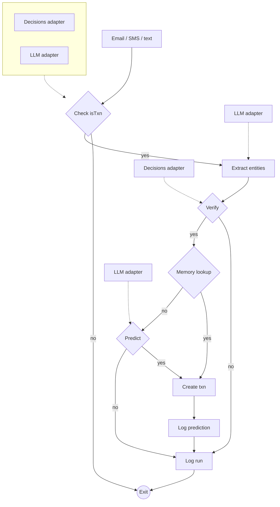

# Prediction flow (target, hexagonal)

Status: proposed, not implemented. The current pipeline is described in [cipher.md](cipher.md). The wider agentic design lives in the "Pennywise — Agentic Pipeline Architecture" doc (https://claude.ai/artifact/DiYdtGjxUofGtUvZstQvDX).

An incoming message passes four gates before a transaction is written: is it a transaction, extract, verify, then memory or prediction. Each gate is a port with adapters plugged in beside it, and the deterministic adapters run before the LLM ones. A memory hit goes straight to Create txn, so the LLM predictor only runs on a miss.

| Step | Port (proposed name) | Adapters | On "no" |
| --- | --- | --- | --- |
| Check isTxn | `TxnDetector` | Decisions, then LLM | Exit |
| Extract entities | `EmailExtractor` | LLM | — |
| Verify | `Verifier` | Decisions | Log run, exit |
| Memory lookup | `MemoryLookup` | Payee rules, pgvector | Predict |
| Predict | `Predictor` | LLM | Log run, exit |
| Create txn | `TransactionWriter` | go-pennywise-api | — |
| Log prediction, log run | `DecisionRecorder` | Postgres | — |

The input is any message (email, SMS or text), so the ports take a source-neutral message rather than an email body. `internal/ports/extractemail` is the first of these ports.
